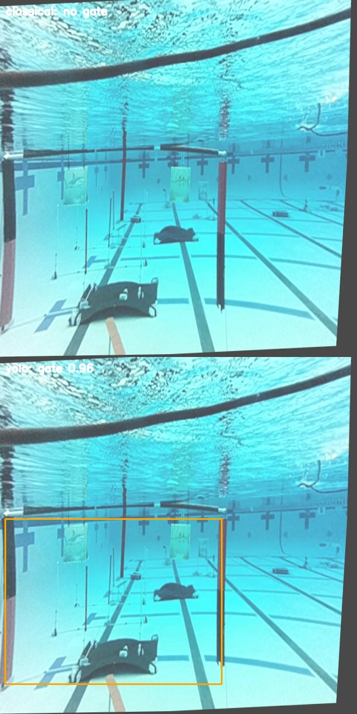
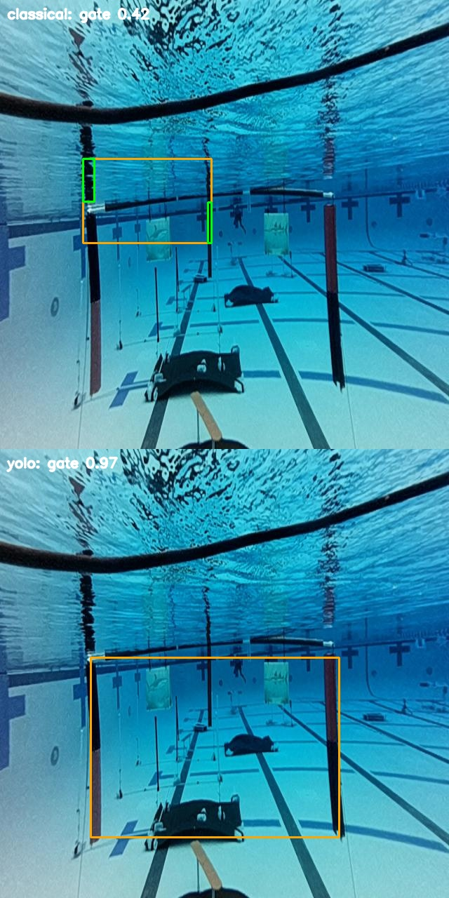
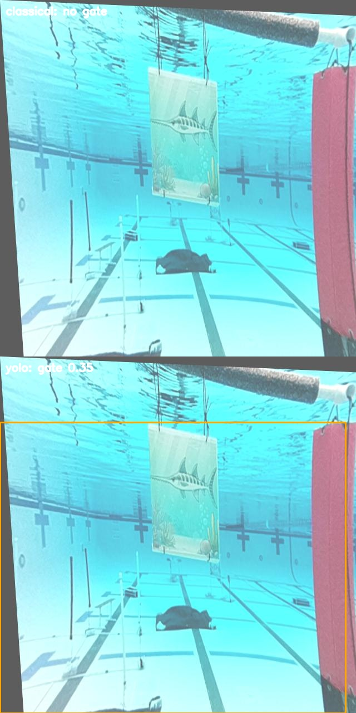

# Gate Perception Evaluation

## Setup

```bash
git clone --recursive https://github.com/berkeleyauv/intro-perception.git
cd intro-perception
./scripts/setup.sh --yolo
source .venv/bin/activate
```

I used the setup script with `--yolo` so I could train and run everything locally. Training automatically ended up using MPS on my Mac.

## Dataset

I used the provided labeled dataset and split it with:

```bash
intro-perception-data split --data data/raw
```

My final splits were:

| Split | Images | Gate | No Gate | Cut-off Gates |
|---|---:|---:|---:|---:|
| Train | 1467 | 1193 | 274 | 619 |
| Validation | 183 | 147 | 36 | 79 |
| Test | 183 | 140 | 43 | 71 |

I got the cut-off counts using the `truncated` field in the provided manifest. There ended up being a pretty large amount of cut-off gates, especially in the training set.

## Classical

For classical, the main thing I changed was how the possible gate posts get paired. Originally it pretty much just took the two biggest candidates, which could go wrong pretty easily when theres other vertical stuff in the image.

Instead I compared possible pairs using their height similarity, vertical alignment, and how far apart they are. I still made it return no gate if it can't find two reasonable posts instead of just guessing.

It still uses the red/black segmentation, morphology, geometry filtering, post pairing, and confidence score. I also kept the combined mask in the debug output.

## YOLO Training

For YOLO I used the default pretrained YOLO26 nano model and trained for 30 epochs at 640 px.

```bash
intro-perception-train \
  --data data/generated/dataset.yaml \
  --model yolo26n.pt \
  --epochs 30 \
  --imgsz 640 \
  --output artifacts/yolo/best.pt
```

Training automatically used Apple MPS and the best weights got copied to `artifacts/yolo/best.pt`. I didn't commit the weights.

## Evaluation

I ran both methods on the same 183 held-out test images:

```bash
intro-perception-run \
  --data data/generated/test/images \
  --output outputs/final_comparison \
  --method both \
  --model artifacts/yolo/best.pt
```

Then evaluated each prediction file:

```bash
python -m intro_perception.evaluate \
  --test-dir data/generated/test \
  --predictions outputs/final_comparison/predictions_classical.jsonl

python -m intro_perception.evaluate \
  --test-dir data/generated/test \
  --predictions outputs/final_comparison/predictions_yolo.jsonl
```

## Results

| Metric | Classical | YOLO |
|---|---:|---:|
| Precision @ IoU 0.50 | 0.2472 | 0.9161 |
| Recall @ IoU 0.50 | 0.1571 | 0.9357 |
| mAP50 | 0.0853 | 0.9066 |
| Normalized Center Error | 0.0445 | 0.0059 |
| FPS | 704.7 | 19.5 |

### Classical

```json
{
  "fps": 704.6963106532863,
  "frames": 183,
  "map50": 0.08529866291465,
  "mean_center_error": 0.044548740397698405,
  "precision_iou50": 0.24719101123595505,
  "recall_iou50": 0.15714285714285714
}
```

### YOLO

```json
{
  "fps": 19.519015273405696,
  "frames": 183,
  "map50": 0.9066018824425671,
  "mean_center_error": 0.005896849039145762,
  "precision_iou50": 0.916083916083916,
  "recall_iou50": 0.9357142857142857
}
```

## Failure Modes

There were 3 main issues I noticed with classical.

### Missing the gate

Sometimes the gate is pretty clearly there but classical just says `no gate`. Since it depends on the segmentation and geometry checks, if the posts dont make it through those then theres nothing for it to pair.

### Pairing the wrong stuff

Another issue is that theres a lot of random vertical stuff underwater that can look like a post. I had cases where classical technically found a gate, but it paired the wrong things and the box ended up nowhere near the actual gate.

### Cut-off gates

Cut-off gates were also a problem. Classical wants two reasonable posts before it calls something a gate, so when part of the gate leaves the frame that assumption starts to hurt it. YOLO handled these cases a lot better from what I saw.

## Speed vs Accuracy

This was probably the biggest difference between them. Classical is insanely fast at about 705 FPS, while YOLO was only around 19.5 FPS.

But YOLO is also way more accurate. The mAP50 went from 0.0853 for classical to 0.9066 for YOLO, and the precision/recall difference is also pretty huge. The center error was way lower too.

So classical definitely wins on speed, but I don't think that speed means much if its missing or incorrectly locating this many gates.

## Training Data

The YOLO training split had 1467 images total, with 1193 gate images and 274 no-gate images. 619 of them were also marked as cut-off.

I think having that many different examples helped YOLO a lot, especially for gates that aren't fully in frame. It isn't relying on one exact color or geometry setup like classical is.

Training coverage is still a limitation though. If the actual pool looks really different from the training images, YOLO could obviously start doing worse. I would want more weird lighting, angles, distances, and partial gates if I kept adding to the dataset.

## Classical Assumptions

Classical is basically assuming that it can segment the red/black parts of the gate and then find two vertical posts that make sense together.

That works really fast, but underwater lighting messes with color a lot and theres also other vertical objects everywhere. It gets even harder when the gate is cut off since there might not even be two posts available to pair.

YOLO doesn't really have that same hard two-post requirement, which is a big reason I think it handled the harder examples better.

## Known Limitations

Classical is really dependent on its color thresholds and geometry rules. Different lighting can mess up the mask, random vertical objects can get paired together, and partial gates can get missed.

YOLO is way slower and needs trained weights. Its also only as good as the data it was trained on, so theres no guarantee it performs the same if the actual environment looks really different.

I also only evaluated on the provided test set, so this obviously doesn't cover every possible underwater condition.

## What I Would Deploy

I would use YOLO. 19.5 FPS is a lot slower than classical, but its still usable and the accuracy difference is massive.

If I had more time I would mostly work on making YOLO faster without killing the accuracy. I'd probably start with a lower inference resolution, then maybe look at quantization or another optimized format. I would also add more difficult training images.

## Annotated Examples

These were 3 examples I thought showed the difference pretty well.

### Missed Gate

Classical says `no gate` here even though the gate is visible, while YOLO still finds it.



### Wrong Pairing

Here classical grabs the wrong vertical stuff instead of the actual gate. YOLO does a much better job localizing it.



### Cut-Off Gate

This one is partially outside the frame. Classical doesn't find a gate, while YOLO can still pick up the visible part.

